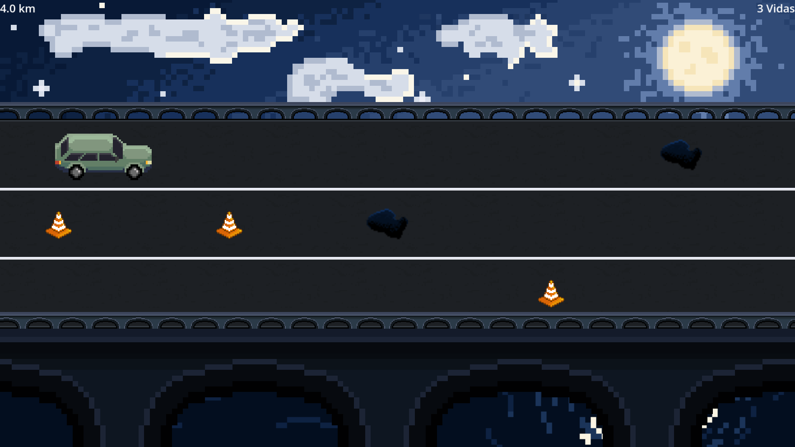
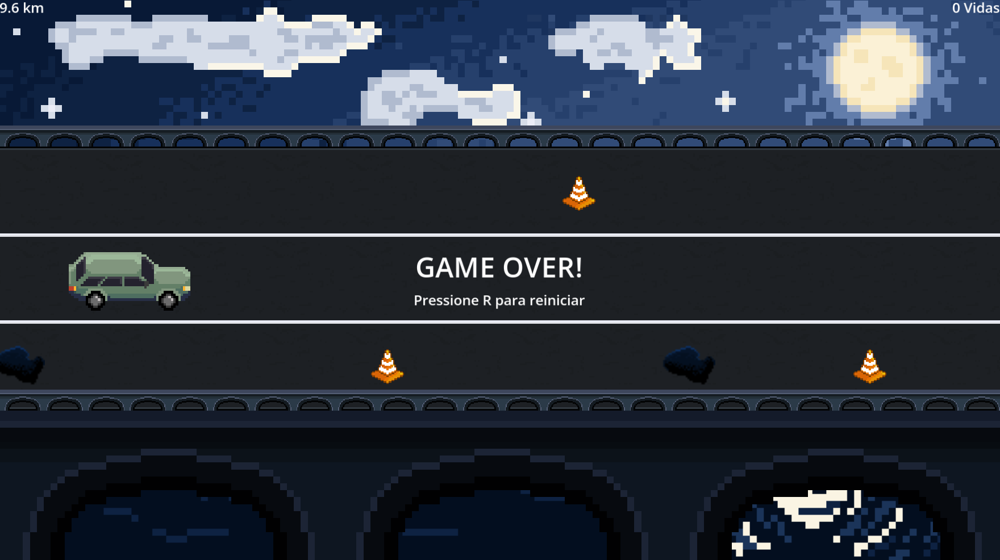

# Night Drive

Night Drive is a 2D pixel-art driving prototype developed in Godot. The player drives along an endless nighttime road, switching between three lanes to avoid obstacles while trying to travel as far as possible.

The project was created as a hands-on study of game development concepts including scene instantiation, signals, collision detection, game states, reusable resources, UI, and endless scrolling environments.

## Screenshots

## Gameplay

The player can move between three lanes while obstacles continuously approach from the right side of the screen.

Colliding with an obstacle removes one life and temporarily reduces the speed of the world. The game ends when all three lives are lost.

## Features

- Three-lane player movement
- Random obstacle spawning
- Multiple obstacle types
- Life system
- Temporary slowdown after collisions
- Distance tracking
- Pause system
- Game over and restart flow
- Reusable scenes and signals
- Endless scrolling road and bridge elements
- Original pixel-art environment and sprites

## Controls

- **W / Up Arrow** - Move one lane up
- **S / Down Arrow** - Move one lane down
- **Space** - Pause / resume
- **R** - Restart after game over

## Built With

- **Godot Engine 4.7**
- **GDScript**
- **Compatibility renderer**
- Original pixel art created for the project

## Project Status

**Prototype / Work in Progress**

This version focuses on the core gameplay loop and the main visual direction.

Future improvements may include additional obstacle types, environmental effects, weather, audio, more varied road scenery, and further gameplay balancing.

## What I Practiced

This project helped me practice:

- Godot scenes and nodes
- Instantiating reusable scenes
- Custom signals and signal connections
- `Area2D` collision detection
- `CharacterBody2D` movement
- Timers
- Game state management
- UI with `CanvasLayer` and Control nodes
- Reusing textures across multiple sprites
- Endless scrolling and object recycling
- Organizing gameplay responsibilities across multiple scripts